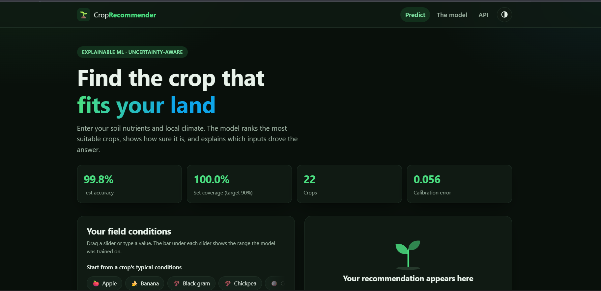
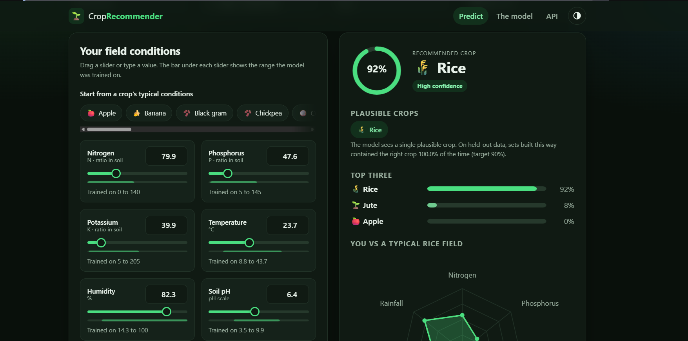
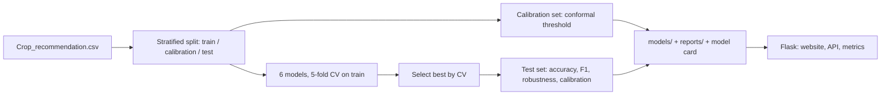
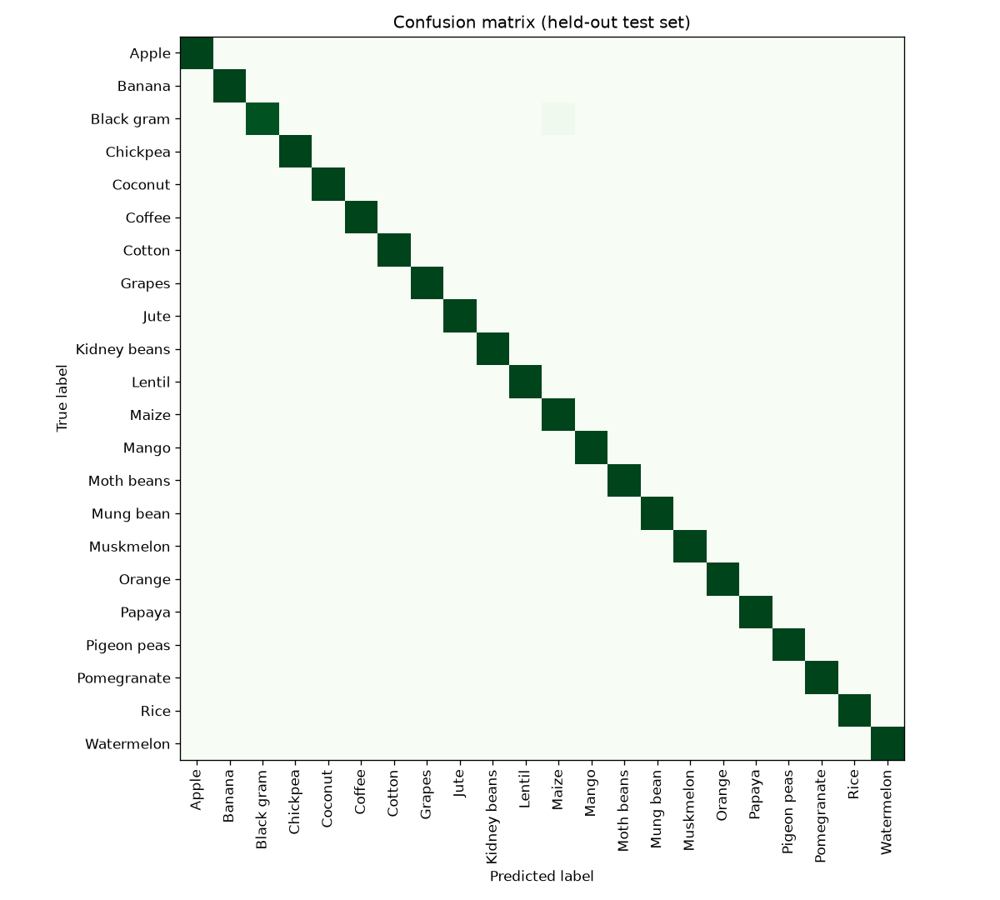
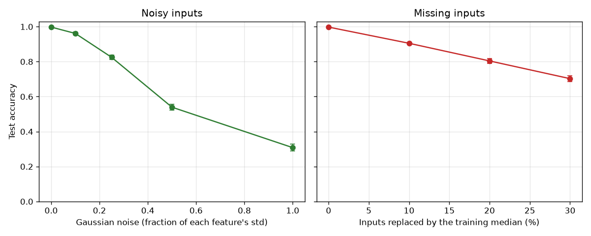
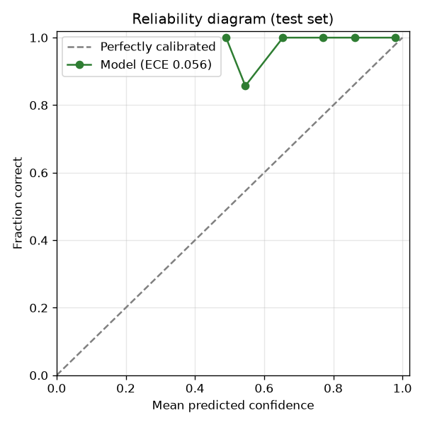

# Crop Recommendation System


A machine-learning web service that recommends the most suitable crops from soil nutrients (N, P, K, pH) and climate conditions (temperature, humidity, rainfall). It goes beyond "train a model and show an accuracy": it measures how far the model can be trusted (robustness, calibration, conformal prediction sets), explains every recommendation, and ships as a tested, observable service with a polished interface.

> Educational project built on a public dataset. It is not agronomic advice.




## What is inside

| Area | What is implemented |
|---|---|
| **Honest evaluation** | Three stratified splits (train / calibration / test). Six models compared with cross-validation; the winner is chosen on the training split only, and the test set is used once. Optional nested cross-validation for hyperparameter tuning (`--tune`). Fixed seed, dataset SHA-256 and library versions recorded. |
| **Uncertainty** | **Conformal prediction sets**: instead of one overconfident answer, the app returns a set of plausible crops with a target coverage (default 90%), and the measured coverage on the test set is reported. Also a reliability diagram, expected calibration error and log loss. |
| **Robustness** | Test accuracy under input noise and under missing inputs, plus a multivariate unusual-input check (Mahalanobis distance). |
| **Explanations** | Every recommendation shows how much each input moved the probability, plus a radar chart comparing your field with a typical field for that crop. |
| **Interface** | Responsive light/dark UI with sliders, crop presets, live updates without page reloads, accessible markup, and charts drawn as server-side SVG, so it works under a strict Content-Security-Policy with no CDNs and no inline styles. |
| **API** | `POST /api/predict`, `POST /api/predict/batch` (up to 100 items), `GET /api/model`, OpenAPI description at `/openapi.json`. |
| **Operations** | Rate limiting, request IDs and structured JSON logs, Prometheus metrics at `/metrics`, `/health`, security headers, Dockerfile (non-root, health check). |
| **Quality** | 45 unit and web tests, linting, test coverage, GitHub Actions on Python 3.11 and 3.12, auto-generated model card. |

## How it works



## Quickstart

```bash
git clone https://github.com/DHarikaRao/crop-recommendation-system.git
cd crop-recommendation-system

python -m venv venv
source venv/bin/activate        # Windows: venv\Scripts\activate
pip install -r requirements.txt
```

**Get the dataset.** Download `Crop_recommendation.csv` (the "Crop Recommendation Dataset" on Kaggle: 2,200 rows, 22 crops, 7 features) and save it as `data/Crop_recommendation.csv`. The file is not redistributed in this repository.

```bash
python train.py          # about a minute; writes models/ and reports/
python train.py --tune   # nested-CV hyperparameter tuning (a few minutes)
python app.py            # open http://127.0.0.1:5000
```

## Results

Everything below comes from `python train.py` on the Kaggle dataset (2,200 rows, 22 crops). The full report is in [`reports/model_card.md`](reports/model_card.md).

| Metric | Value |
|---|---|
| Selected model | Random Forest (5-fold CV 99.7% ± 0.2%) |
| Held-out test accuracy / macro F1 | 99.8% / 0.998 |
| Conformal set coverage (target 90%) / average set size | 100.0% / 1.18 crops |
| Accuracy at 0.25 std input noise | 82.5% |
| Accuracy with 20% of inputs missing | 80.4% |
| Expected calibration error / log loss | 0.056 / 0.067 |





**What I learned**

- Random Forest won by cross-validation, but Gaussian Naive Bayes was within 0.3 points on the test set. The crops are cleanly separable in this dataset, so the headline accuracy says little about real-world performance.
- The headline hides fragility. Adding noise of 0.25 standard deviations to the inputs drops accuracy to 82.5%, and 0.5 standard deviations to 54.0%. Replacing 20% of inputs with the training median gives 80.4%. Real soil tests have measurement error, so real accuracy would be lower.
- Humidity, nitrogen and rainfall drive the predictions; temperature and pH barely change accuracy when shuffled (0.011 each), although permutation importance can understate correlated inputs.
- Conformal prediction sets reach 100.0% coverage against a 90% target, with sets averaging 1.18 crops. 91% of test inputs get a single crop, and 9% have no crop above the confidence bar, so the app shows the three best guesses for them instead of a misleading single answer.
- The reliability diagram shows the Random Forest is under-confident: predictions made with roughly 50-65% confidence were right 86-100% of the time (some bins hold few predictions), so the Low and Medium confidence labels are conservative.

## Understanding the uncertainty features

- **Plausible crops (conformal prediction).** The model is calibrated on rows it never trained on so that the returned set contains the right crop at least 90% of the time on similar data. When one crop clears the confidence bar you get a single crop; when none does, the app shows the three best guesses and flags the answer as uncertain (adding crops can only raise coverage). The guarantee is averaged over inputs and assumes new data resemble the calibration data.
- **Unusual-input warning.** The Mahalanobis distance to the pooled training data flags combinations that are far from everything the model has seen. Per-input range warnings are separate.
- **"Why this crop?"** Each input is replaced by the dataset median in turn and the change in the recommended crop's probability is shown. It can understate the effect of correlated inputs.

## API

```bash
curl -X POST http://127.0.0.1:5000/api/predict \
  -H "Content-Type: application/json" \
  -d '{"N": 90, "P": 42, "K": 43, "temperature": 21, "humidity": 82, "ph": 6.5, "rainfall": 200}'
```

The response has the top three crops, a confidence level, the plausible set, an unusual-input flag, warnings and a per-input explanation (`effect_pp` is the change in the top crop's probability, in percentage points).

| Endpoint | Purpose |
|---|---|
| `POST /api/predict` | Recommendations for one set of conditions |
| `POST /api/predict/batch` | Up to 100 sets of conditions; one result (or field errors) per item |
| `GET /api/model` | Selected model, test metrics, calibration and coverage |
| `GET /openapi.json` | OpenAPI 3 description |
| `GET /metrics` | Prometheus metrics |
| `GET /health` | Liveness and whether a model is loaded |

Invalid input returns `400` with one message per field. POST requests are limited per client (default 120 per minute, set `RATE_LIMIT_PER_MINUTE`); over the limit returns `429` with `Retry-After`. Every response carries an `X-Request-ID` (an incoming one is echoed if it is safe) that also appears in the JSON logs.

## Design decisions

- **Choose models by cross-validation, never by test score.** Picking the best of six on the test set would leak information into the reported number. With `--tune`, tuning happens inside each fold (nested CV), so the CV scores are not inflated.
- **A separate calibration split for conformal prediction.** It keeps the coverage guarantee valid, at the cost of training on 60% of the data. The dataset is clean enough that this barely matters; on a harder dataset you would weigh that trade-off.
- **Charts as server-side SVG.** No chart library and no inline styles, so the strict Content-Security-Policy stays on and the pages work without JavaScript (JavaScript only adds sliders, presets and no-reload updates).
- **One gunicorn worker with threads.** Metrics and the rate limiter live in process memory, so a single worker keeps them consistent. For several workers, move them to a shared store (for example `prometheus_client` multiprocess mode and Redis).
- **Model committed, data not.** The trained model is small and lets a host deploy without the dataset; the CSV stays out of the repo.

## Docker

```bash
docker build -t crop-recommender .
docker run -p 8000:8000 crop-recommender     # http://localhost:8000
```

Train first so `models/crop_model.joblib` exists before building, or the container starts without a model and reports it on `/health`.

## Deployment

On a host such as Render, use build command `pip install -r requirements.txt` and start command `gunicorn app:app --bind 0.0.0.0:$PORT --workers 1 --threads 4`. Commit `models/` and `reports/` after training so the deployed site has a model to serve. If the host sits behind a proxy, rate limiting sees the proxy's address unless you add `werkzeug.middleware.proxy_fix.ProxyFix`.

## Tests

```bash
pip install -r requirements-dev.txt
ruff check .
python -m pytest -q --cov=. --cov-report=term-missing
```

The tests train on a small synthetic dataset, so they run in seconds and need no downloads. They cover training, conformal sets, robustness, calibration, explanations, validation, the API, rate limiting, request IDs, metrics, the OpenAPI spec, chart geometry, and a check that no page emits inline styles or scripts.

## Limitations

- The dataset is small, balanced and unusually clean, so scores here will not transfer to real fields.
- Only seven inputs are used. Soil type, location, season, irrigation, prices and pests are unknown to the model.
- Conformal coverage is a marginal guarantee; coverage for an individual crop can differ, and it can fail under distribution shift.
- The unusual-input check is coarse because the training data forms one cluster per crop.
- Metrics and rate-limit state are per process and reset on restart.

## Project structure

```text
├── app.py               # Flask app factory: pages, API, middleware
├── crop_model.py        # data, training, conformal sets, OOD, robustness, calibration, explanations
├── train.py             # command-line training (--tune for nested CV)
├── viz.py               # SVG chart geometry
├── metrics.py           # Prometheus-format metrics
├── ratelimit.py         # sliding-window rate limiter
├── openapi.py           # OpenAPI description
├── templates/ static/   # responsive UI (light and dark)
├── tests/               # unit and web tests
├── models/ reports/     # created by train.py (commit them)
├── Dockerfile  Procfile docker-compose.yml
└── data/                # dataset goes here (git-ignored)
```

## Roadmap

- Soil type and season as inputs
- Load test with Locust or k6 and a note on bottlenecks
- Drift monitoring on incoming inputs
- Live demo link

## License

MIT. See [LICENSE](LICENSE).
